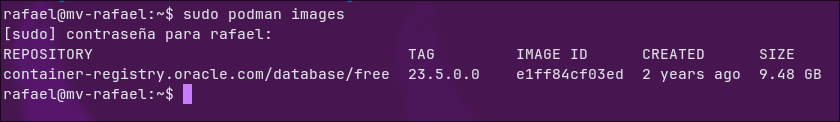
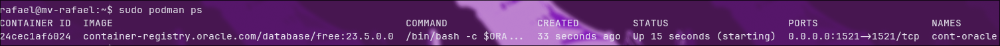
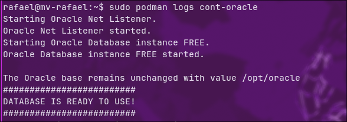
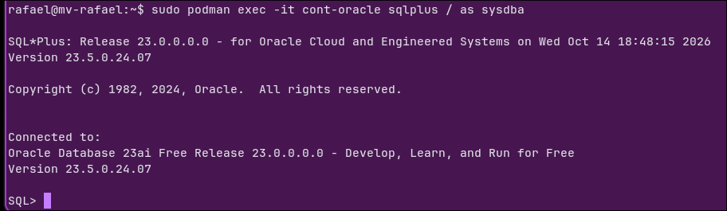
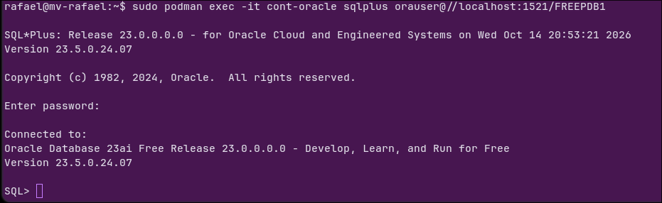
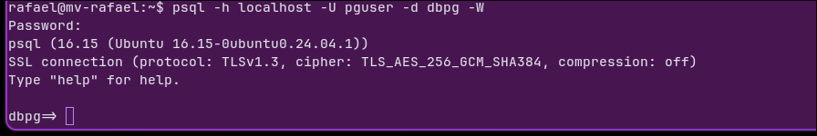
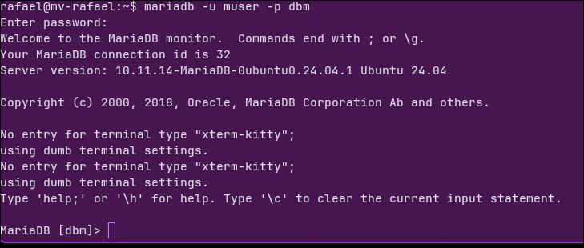

# Instalación SGBD

## Características de la VM

## Preparamos Podman y descargamos la imagen
`sudo apt update`
Actualizamos todos los paquetes (esto no descarga las actualizaciones solo los actualiza)
`sudo apt install podman`
Descargamos Podman
`sudo podman pull container-registry.oracle.com/database/free:23.5.0.0`
Descargamos la iamgen de contenedor pero no la ejecutamos
`sudo podman images`
Lista las imagenes que tenemos instaladas en el equipo

## Crear y comprobar el contenedor
`sudo podman volume create oracle_23ai_datos`
Crea un volumen gestionado por **Podman** este existe fuera del contenedor. Sirve para que no se pierdan los datos por si se borra el contenedor.
`sudo podman run -d --name cont-oracle -p 1521:1521 --restart=always -v oracle_23ai_datos:/opt/oracle/oradata:U container-
registry.oracle.com/database/free:23.5.0.0`
Crea y arranca el contenedor apartir de la imagen que descargamos.
`sudo podman ps `

Muestra los contenedores que están en **ejecución**.
`sudo podman ps -a`
Muestra todos los contonedores incluso los que estan parados o los que han fallado.
`sudo podman logs cont-oracle` 
Muestra la salida del contenedo, es decir lo que oracle escribe mientras arranca.

## Entra en Oracle y crear el usuario de trabajo

`sudo podman exec -it cont-oracle /bin/bash`
Entramos en la consola de bash del contenedor
`exit`
salimos de la consola de bash
`sudo podman exec -it cont-oracle sqlplus / as sysdba`
Entramos en la consola de SQL del contenedor

### Vamos a crear el usuario

`SHOW PDBS`
Lista las bases de datos que hay **dentro del contenedor raíz**
`ALTER SESSION SET CONTAINER = FREEPDB1;`
Te mueves de la **raíz** a **FREEPDB1**
`CREATE USER orauser IDENTIFIED BY "TU CLAVE";`
Crea el usuario **orauser** con la contraseña que le pongamos
`GRANT CREATE SESSION, CREATE TABLE TO orauser;`
Da **permisos** para **conectarse** a la base de datos y para **crear tablas**
`ALTER USER orauser QUOTA 100M ON USERS;`
Le asigna **100MB** de espacio donde se guardan los datos de las tablas
`EXIT`
Sale de SQL

### Comprobaremos la conexión al usuario que acabamos de crear

`sudo podman exec -it cont-oracle sqlplus orauser@//localhost:1521/FREEPDB1`
Nos conectamos a la base de datos con el usuario orauser

## Desplegar PostgreSQL
`sudo apt update`
Actualiza la **lista de paquetes** disponibles
`sudo apt install postgresql postgresql-contrib php-pgsql`
Instala **PostgreSQL**, sus **extensiones extra** y el **conector de PHP** para PostgreSQL
`sudo systemctl start postgresql`
**Arranca** el servicio de PostgreSQL
`sudo systemctl enable postgresql`
Hace que PostgreSQL **se inicie solo** al encender la máquina
`sudo -i -u postgres`
Entramos como el usuario **postgres** (el administrador de PostgreSQL)
`psql`
Abre la **consola de SQL** de PostgreSQL

### En psql
`CREATE DATABASE dbpg;`
Crea la base de datos **dbpg**
`CREATE USER pguser WITH PASSWORD 'TU_CLAVE';`
Crea el usuario **pguser** con la contraseña que le pongamos
`GRANT ALL PRIVILEGES ON DATABASE dbpg TO pguser;`
Da **todos los permisos** sobre la base de datos **dbpg** al usuario **pguser**
`\q`
Sale de **psql**

### Comprobamos la conexión
`exit`
Salimos del usuario **postgres** y volvemos a nuestro usuario
`psql -h localhost -U pguser -d dbpg -W`
Nos conectamos como **pguser** a **dbpg** (-h servidor, -U usuario, -d base de datos, -W pide contraseña)

## Desplegar MariaDB
`sudo apt install mariadb-server mariadb-client`
Instala el **servidor** de MariaDB y el **cliente** para conectarse a él

`sudo systemctl enable --now mariadb`
Hace que MariaDB **se inicie solo** al encender la máquina y lo **arranca ya** (--now)

`sudo mariadb`
Entramos en la **consola de MariaDB** como **root** (administrador), sin contraseña

### En el indicador de MariaDB
`CREATE DATABASE dbm CHARACTER SET utf8mb4 COLLATE utf8mb4_unicode_ci;`
Crea la base de datos **dbm** con codificación **utf8mb4** (admite tildes, ñ y emojis)

`CREATE USER 'muser'@'localhost' IDENTIFIED BY 'TU_CLAVE';`
Crea el usuario **muser** que solo puede conectarse **desde la propia máquina** (localhost)

`GRANT ALL PRIVILEGES ON dbm.* TO 'muser'@'localhost';`
Da **todos los permisos** sobre **todas las tablas** de **dbm** (dbm.*) al usuario **muser**

`FLUSH PRIVILEGES;`
**Recarga los permisos** para que se apliquen

`EXIT;`
Sale de **MariaDB**

`mariadb -u muser -p dbm`
Nos conectamos como **muser** a **dbm** (-u usuario, -p pide contraseña)

## Comprobaciones

`nc -zv localhost PUERTO`
Comprueba si el **puerto** está abierto y responde (-z solo comprueba, -v muestra el resultado)

| SGBD | Puerto | Resultado nc | Conexión con cliente |
|---|---|---|---|
| Oracle 23ai Free | 1521 | succeeded | OK — orauser en FREEPDB1 |
| PostgreSQL | 5432 | succeeded | OK — pguser en dbpg |
| MariaDB | 3306 | succeeded | OK — muser en dbm |

`SHOW USER` / `SHOW CON_NAME`
En Oracle, muestra el **usuario** conectado y la **base de datos** (PDB) en la que estamos

`SELECT current_user, current_database();`
En PostgreSQL, muestra el **usuario** y la **base de datos** actuales

`SELECT CURRENT_USER(), DATABASE();`
En MariaDB, muestra el **usuario** y la **base de datos** actuales

